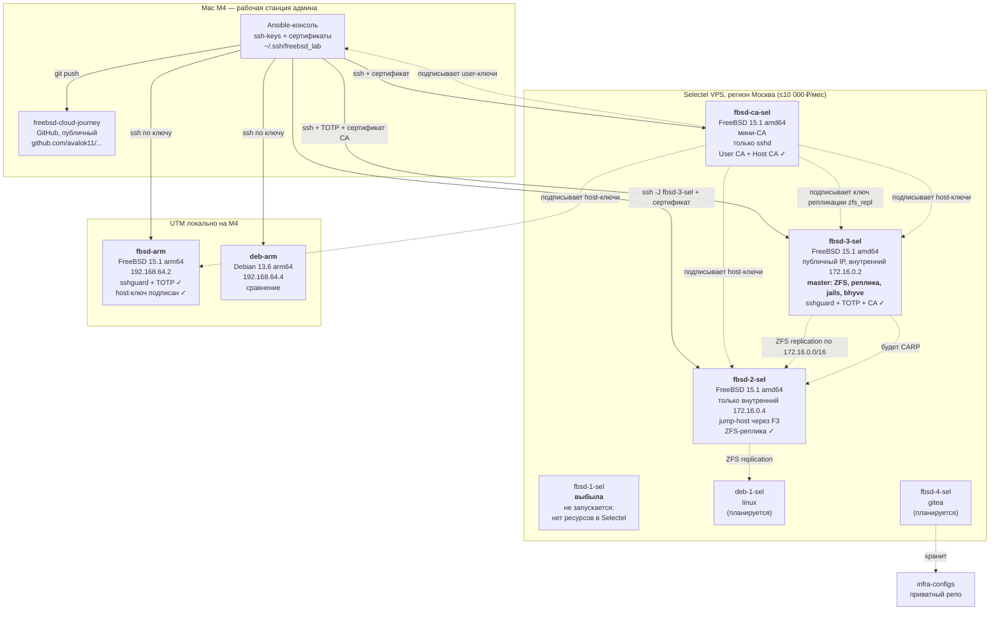

# Архитектура FreeBSD Private Cloud

Целевая архитектура продуктового кластера. Диаграмма в формате Mermaid — GitHub рисует её автоматически.

## Текущая фактическая топология (после 2026-10-27)

> **Изменение 2026-10-27.** Мастер-нода `fbsd-1-sel` выбыла: Selectel не может
> её запустить — не хватает ресурсов после массовой миграции компаний в дата-центр.
> Взамен поднимается `fbsd-3-sel`, которая занимает роль master'а. `fbsd-ca-sel` и
> `fbsd-2-sel` продолжают работать. Подробно — в
> [`phase-2/00-fbsd-3-sel-provisioning.md`](./phase-2/00-fbsd-3-sel-provisioning.md).

### Роли нод на весь курс

| Нода | Роль | Фазы | Состояние |
|---|---|---|---|
| `fbsd-ca-sel` | SSH CA: подпись ключей, CRL | 0.1 → 8 | работает |
| `fbsd-3-sel` | **master**: ZFS-пул, источник репликации, jails, Bastille, bhyve; позже HA-мастер, Gitea, мониторинг | 1.5 → 8 | разворачивается |
| `fbsd-2-sel` | реплика ZFS; jump-only к `fbsd-3-sel`; позже HA-бэкенд | 1 → 8 | работает |
| `fbsd-arm` | arm64-лаборатория: jails, PF, ZFS, Bastille, сравнение с amd64 | 0 → 8 | локально, работает |
| `deb-arm` | Linux-мост | 0 → 8 | локально, работает |
| `fbsd-1-sel` | **выбыла**; при возвращении — ре-сид с master'а либо второй HA-узел | — | не запускается |

### Если `fbsd-1-sel` вернётся

| Сценарий | Как использовать |
|---|---|
| **Ре-сид (рекомендуется)** | Наполнить данными с master'а через `zfs send`/`zfs receive` — второй практический кейс DR почти бесплатно |
| **Второй HA-узел** | Пара `fbsd-3-sel` + `fbsd-1-sel` для CARP в Фазе 3; с тремя нодами можно проверить split-brain |
| **Снести** | Освободить деньги, если ресурсы в Selectel дорогие |

## Принципы

1. **Ноутбук — не часть кластера.** Это рабочая станция админа, через которую идёт управление.
2. **Динамический домашний IP — не проблема.** Все подключения инициируются от ноутбука к Selectel, обратного трафика нет.
3. **Два репозитория:**
   - `freebsd-cloud-journey` (GitHub, публичный) — кейс, отчёты, схемы, портфолио.
   - `infra-configs` (Gitea, приватный) — Ansible, конфиги, secrets. **Никаких реальных IP, доменов, сертификатов в публичном репо.**
4. **Локально — для экспериментов.** На M4 в UTM поднимаем FreeBSD arm64 для отладки, можно ломать без боли.
5. **Удалённо — production-like.** В Selectel FreeBSD amd64, как у реального заказчика.
6. **Межсервисный трафик — по приватной сети Selectel.** Репликация ZFS, сервисный SSH `zfs-repl`, будущий CARP/heartbeat — всё через `172.16.0.0/16`, не через интернет. Дешевле, быстрее, меньше поверхность атаки.

## Что развёрнуто на 2026-10-26

### Selectel

| Нода | Хостнейм | ОС | Внешний IP | Внутренний IP | Назначение | Статус |
|---|---|---|---|---|---|---|
| **fbsd-1-sel** | `fbsd-1-sel.lab.sel` | FreeBSD 15.1-RELEASE amd64 | `178.72.xxx.xxx` (замазан) | `172.16.0.2/16` (vtnet0) | Шлюз, тест-нода, jump-host | **активен**, sshguard + TOTP + CA-доверие |
| **fbsd-ca-sel** | `fbsd-ca-sel.lab.sel` | FreeBSD 15.1-RELEASE amd64 | `178.72.xxx.xxx` (замазан) | `172.16.0.3/16` (vtnet0) | Мини-CA, только sshd | **активен**, User CA + Host CA, CRL, вход с Mac M4 напрямую |
| **fbsd-2-sel** | `fbsd-2-sel.lab.sel` | FreeBSD 15.1-RELEASE amd64 | **нет** (только приватный) | `172.16.0.4/16` (vtnet0) | ZFS-реплика, будущая CARP-пара | **активен**, sshguard + CA-доверие, вход через `ssh -J fbsd-1-sel` (TOTP снят 2026-09-06, см. раздел «Безопасность на `fbsd-2-sel`» ниже) |

### Локальный стенд (UTM на Mac M4)

| ВМ | Хостнейм | ОС | IP | Назначение | Статус |
|---|---|---|---|---|---|
| **fbsd-arm** | `fbsd-arm` | FreeBSD 15.1 arm64 | `192.168.64.2` | Эксперименты | **активен**, sshguard + TOTP, host-ключ подписан |
| **deb-arm** | `deb-arm` | Debian 13.6 arm64 | `192.168.64.4` | Сравнение с Linux | **активен**, ssh по ключу |

## Сеть

| Сеть | Назначение | CIDR |
|---|---|---|
| **Публичная** (Selectel) | Доступ из интернета, ssh, http | Выдаётся Selectel |
| **Приватная Selectel** | Связь между нодами внутри дата-центра | `172.16.0.0/16` (по умолчанию) |
| **Host-Only UTM** (локально) | Связь Mac M4 ↔ локальные ВМ | `192.168.64.0/24` |
| **CARP / внутренняя** (планируется) | Связь между FreeBSD-нодами для HA | `10.10.0.0/24` |
| **Storage** (планируется) | ZFS-репликация | `10.10.1.0/24` |
| **Bastille VNET** (планируется) | Сеть для jail-ов | `10.10.10.0/24` |

## Безопасность на FreeBSD-нодах (fbsd-1-sel, fbsd-ca-sel, fbsd-arm)

- ✅ SSH по ключу (ed25519, `~/.ssh/freebsd_lab` на Mac M4).
- ✅ TOTP через Yandex Key (`pam_google_authenticator`).
- ✅ `PasswordAuthentication no`, `PermitRootLogin no`.
- ✅ AuthenticationMethods: `publickey,keyboard-interactive:pam`.
- ✅ sshguard + PF (активирован, таблица `<sshguard>`, тест блокировки пройден).
- ✅ ntpd для синхронизации времени.
- ✅ NTP-сервер time.cloudflare.com.
- ✅ **SSH CA (Фаза 0.1 закрыта):** User CA + Host CA на `fbsd-ca-sel`. Host-ключи `fbsd-1-sel`, `fbsd-2-sel`, `fbsd-arm` подписаны (TTL 52w). Пользовательский ключ `freebsd_lab` подписан (TTL 8h, переподпись). CRL настроен вручную, проверен. **Автоматизация CRL — Фаза 4** (Ansible).

## Безопасность на `fbsd-2-sel` (jump-only, без TOTP)

- ✅ SSH по сертификату (User CA + Host CA, вход под `avalok11` по `freebsd_lab-cert.pub`).
- ✅ `PasswordAuthentication no`, `PermitRootLogin no`.
- ✅ AuthenticationMethods: `publickey` (без `keyboard-interactive`).
- ✅ sshguard + PF.
- ✅ ntpd синхронизирован.
- ✅ `user_ca.pub` скопирован на `fbsd-2-sel`, `TrustedUserCAKeys` в `sshd_config`, sshd рестартован — вход по user-сертификату работает.
- ✅ Баннер доделан (через `/etc/motd` и `Banner /etc/issue.net` в `sshd_config`).

**Почему без TOTP:** `fbsd-2-sel` не имеет публичного IP, зайти можно только через `fbsd-3-sel` (jump-host), на котором TOTP уже стоит. Двойной TOTP на цепочке — избыточен и замедляет работу. Единственная защита ноды — пара ed25519-ключ + сертификат CA с TTL 8h, что сознательно принято как tradeoff (см. «Ключевые решения» в `docs/phase-1/README.md`).

## Хранилище (ZFS-пулы) — в работе

| Нода | Пул | Назначение | RAID |
|---|---|---|---|
| fbsd-3-sel | zroot + tank | **master**: система + данные + jails | stripe на Selectel (1 диск); mirror в проде |
| fbsd-2-sel | zroot + tank | Система + приёмник реплики (`zroot/tank/repl`) | stripe на Selectel |
| fbsd-1-sel | — | выбыла, диск недоступен | — |
| deb-1-sel | tank | Бэкапы, offsite-реплики | mirror (планируется) |

## Сервисы в Bastille-jails (планируется)

| Jail | Сервис | Порт |
|---|---|---|
| nginx | Reverse proxy | 80, 443 |
| app | PHP-FPM / приложение | 9000 (internal) |
| db | PostgreSQL | 5432 (internal) |
| mail | Postfix + Dovecot | 25, 143, 587 |
| monitor | Prometheus + Grafana | 9090, 3000 |

Точные конфигурации — в Фазе 2.

## История изменений

- **2026-10-27 (v3.5, unplanned: выбыл fbsd-1-sel, появился fbsd-3-sel)** — мастер-нода `fbsd-1-sel` перестала запускаться: Selectel не может её поднять, не хватает ресурсов после массовой миграции компаний в дата-центр. `fbsd-ca-sel` и `fbsd-2-sel` работают — вероятно, они на другом физическом сервере. Разворачивается `fbsd-3-sel`: FreeBSD 15.1 amd64, 2 vCPU / 2 ГБ RAM / 40 ГБ SSD, публичный IP, приватный адрес желательно `172.16.0.2` (тогда вся конфигурация Фазы 1 — `from=`, `zfs allow`, пути — остаётся валидной без правок).

  Три следствия, которые пришлось разобрать:
  1. **`fbsd-2-sel` застряла** — её единственный путь входа шёл через `fbsd-1-sel` как jump-host. Новая нода первым делом становится jump-host'ом, реплика снова доступна.
  2. **Данные восстанавливаются с собственной реплики** — `zfs send -R` с `fbsd-2-sel` → `zfs receive` на `fbsd-3-sel`. Механизм Фазы 1 впервые сработал по назначению: это реальный DR-сценарий, а не упражнение.
  3. **Приватный ключ `zfs_repl` потерян** вместе с нодой. CA жив — выпускаем новый ключ и **отзываем старый** через CRL. Первый реальный отзыв сертификата в курсе.

  План: [`phase-2/00-fbsd-3-sel-provisioning.md`](./phase-2/00-fbsd-3-sel-provisioning.md). Роли нод на весь курс пересмотрены: `fbsd-3-sel` — master (ZFS, репликация, jails, bhyve, позже HA-мастер и Gitea), `fbsd-2-sel` — реплика и HA-бэкенд, `fbsd-ca-sel` — CA. `fbsd-1-sel`, если вернётся, — ре-сид с master'а либо второй HA-узел.

- **2026-10-26 (v3.4, Фаза 1 закрыта)** — Неделя 3 завершена: репликация `fbsd-1-sel → fbsd-2-sel` работает end-to-end (полная отправка + инкременты), сервисная учётка `zfs-repl` ограничена `AuthorizedPrincipalsFile` + `zfs allow` без sudo, failover проверен: при выключенном master реплика читается и пишется, после возврата ноды цепочка инкрементов не рвётся. Пункт «сравнение с Linux (ext4+LVM, btrfs) на deb-arm» пропущен по решению и перенесён в Фазу 7. Начинается Фаза 2 (jails, bhyve, Bastille).
- **2026-10-12 (v3.3, по итогам ревизии Дня 3 Фазы 1)** — исправлены фактические ошибки в документации: `fbsd-ca-sel` имеет публичный IP и принимает вход с Mac M4 напрямую (было «jump через F1» — противоречило roadmap и phase-0.1); приватный ключ репликации `zfs_repl` перенесён со схемы ноутбука на `fbsd-1-sel`, где он и живёт (`from="172.16.0.2"` не пускает подключения с ноутбука). Репликация по-прежнему `fbsd-1-sel → fbsd-2-sel` по `172.16.0.0/16`.
- **2026-09-06 (v3.2, Неделя 1 Фазы 1 закрыта)** — `fbsd-2-sel` приведён к финальному виду: TOTP снят, `user_ca.pub` скопирован, `TrustedUserCAKeys` в `sshd_config` + рестарт, баннер в `/etc/motd` + `Banner` в `sshd_config`. Все пункты «Что нужно донастроить» закрыты, раздел удалён. Сеть унифицирована с `fbsd-1-sel` (search domain `lab.sel`, CIDR-нотация, полный DNS-список). PF v2 (antispoof, NAT-stub) применён на обеих нодах через единый `docs/phase-1/pf-ruleset.conf`. Неделя 1 (Сеть + PF) — полностью закрыта.
- **2026-09-06 (v3.1, День 1 Фазы 1, продолжение)** — на `fbsd-2-sel` снят TOTP (jump-only, single factor: ed25519 + сертификат). `user_ca.pub` скопирован на ноду, `TrustedUserCAKeys` — в работе. Причина: `fbsd-2-sel` без публичного IP, единственный путь входа — через `fbsd-1-sel` (где TOTP уже стоит), двойной TOTP на цепочке избыточен.
- **2026-08-30 (v3, День 1 Фазы 1)** — поднят `fbsd-2-sel` в Selectel (FreeBSD 15.1 amd64, только приватный IP `172.16.0.4`, jump-host через `fbsd-1-sel`). Базовый харденинг + sshguard + TOTP + ntpd выполнены. Host-ключ подписан через `fbsd-ca-sel` (TTL 52w). Баннер и User CA-доверие (`TrustedUserCAKeys`) — в работе. Решение: `fbsd-2-sel` остаётся без публичного IP, межсервисный трафик идёт по `172.16.0.0/16`.
- **2026-08-28 (v2.3, Фаза 0.1 закрыта)** — User CA + Host CA на `fbsd-ca-sel`, подписаны host-ключи `fbsd-1-sel` и `fbsd-arm`, CRL настроен, TTL-тест пройден.
- **2026-08-11 (v2.1)** — на fbsd-1-sel активирован sshguard + PF, статус синхронизирован с fbsd-arm.
- **2026-08-11 (v2)** — развёрнут `fbsd-1-sel` в Selectel (FreeBSD 15.1, публичный IP, ssh + TOTP), `deb-arm` в UTM (Debian 13.6). Фактические IP зафиксированы.
- **2026-08-06 (v1)** — стартовая схема, добавлены два репозитория (GitHub + Gitea), гибридный стенд.
