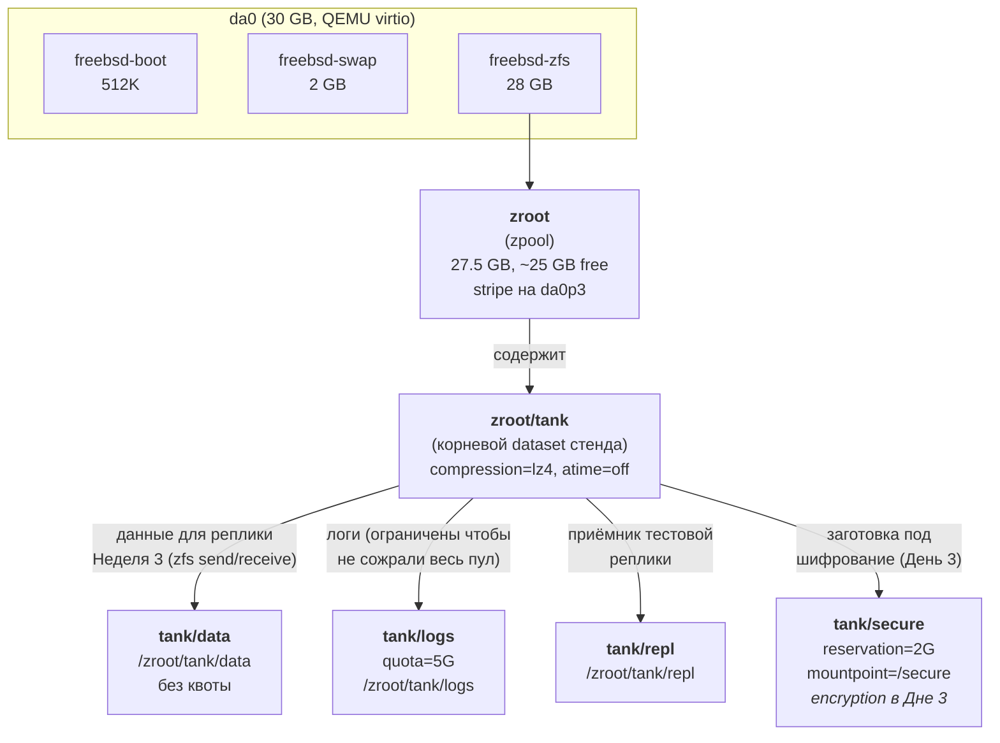
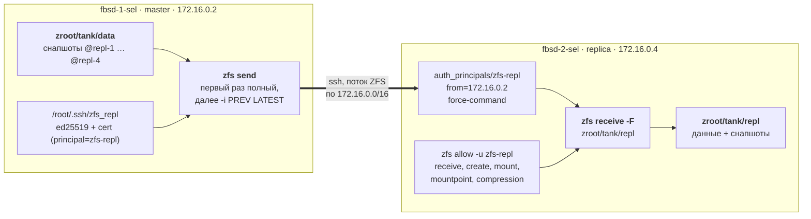

# Phase 1 — ZFS Report

Отчёт по работе с ZFS на FreeBSD 15.1 в Фазе 1. Заполняется по дням Недели 2 и Недели 3.

> **Что здесь и что не здесь.** Этот файл — **механизмы и детали**: команды, реальный
> вывод терминала, параметры пулов и датасетов, схемы, технические грабли. Решения
> уровня фазы (доступ, безопасность, структура стенда) и чеклисты живут в
> [`README.md`](./README.md), настройка сервисной SSH-учётки — в
> [`service-ssh-setup.md`](./service-ssh-setup.md). Чтобы не было двух источников
> правды, решения не дублируются: здесь они лежат рядом с соответствующими командами.

---

## Структура zpool (День 1, 2026-09-13)

**Нода:** fbsd-1-sel (Selectel, FreeBSD 15.1 amd64, 1 vCPU, 1 ГБ RAM, 30 ГБ SSD)
**Пул:** `zroot` (создан при установке FreeBSD), 28 ГБ под `freebsd-zfs`
**Реальное размещение:** `tank` — это **дочерний dataset `zroot/tank`**, а не отдельный zpool

### Почему так, а не отдельный пул

На Selectel VPS выделен один диск `da0` (30 ГБ), уже полностью размечен под систему:
- 512K `freebsd-boot`
- 2G `freebsd-swap`
- 28G `freebsd-zfs` → здесь живёт `zroot`

Свободного места для **отдельного** `zpool create tank /dev/da0p4` нет — четвёртого раздела на диске просто не существует. Поэтому `tank` сделан как **dataset внутри `zroot`**. Это типичное решение для учебного/тестового стенда на 1 диске; в проде (Фаза 3, нормальное железо или VPS с двумя дисками) переделаем на отдельный пул с mirror — `zfs rename -p zroot/tank tank/data` переносит данные без потерь.

### Схема иерархии



### Таблица датасетов

| Датасет | Назначение | quota | reservation | mountpoint | Создаётся в |
|---|---|---|---|---|---|
| `zroot/tank` | корневой dataset стенда | — | — | `/zroot/tank` | День 1 |
| `zroot/tank/data` | данные для реплики (Неделя 3: `zfs send/receive`) | — | — | `/zroot/tank/data` | День 1 |
| `zroot/tank/logs` | логи (защита от переполнения) | **5G** | — | `/zroot/tank/logs` | День 1 |
| `zroot/tank/repl` | приёмник тестовой реплики | — | — | `/zroot/tank/repl` | День 1 |
| `zroot/tank/secure` | заготовка под шифрование | — | **2G** | `/secure` | День 1 (encryption в День 3) |
| `zroot/tank/jails` | rootfs для Bastille-jail'ов (Фаза 2) | — | — | `/zroot/tank/jails` | Фаза 2 |

### Параметры пула и корневого dataset

| Параметр | Значение | Зачем |
|---|---|---|
| ashift | 12 (дефолт) | выравнивание записи на 4K-сектора |
| compression | lz4 (на корне tank и всех детях) | экономия 20–30% на текстовых данных (логи, конфиги), почти без нагрузки на CPU |
| atime | off | не обновлять access-time при чтении, ускоряет I/O на hot-данных |
| recordsize | 128K (дефолт) | стандарт для mixed-workload |

### Вывод `zfs list` после создания

```
NAME                QUOTA  RESERV  COMPRESS  ATIME  MOUNTPOINT
zroot/tank           none    none  lz4       off    /zroot/tank
zroot/tank/data      none    none  lz4       off    /zroot/tank/data
zroot/tank/logs        5G    none  lz4       off    /zroot/tank/logs
zroot/tank/repl      none    none  lz4       off    /zroot/tank/repl
zroot/tank/secure    none      2G  lz4       off    /secure
```

### Вывод `zpool status zroot`

```
  pool: zroot
 state: ONLINE
config:
        NAME        STATE     READ WRITE CKSUM
        zroot       ONLINE       0     0     0
          da0p3     ONLINE       0     0     0

errors: No known data errors
```

### Smoke-тест: запись и чтение

```
echo "test data" | sudo tee /zroot/tank/data/hello.txt
cat /zroot/tank/data/hello.txt
sudo rm /zroot/tank/data/hello.txt
```

Результат: файл создался, прочитался, удалился — I/O работает, dataset смонтирован в правильный путь, права `avalok11:avalok11` (через sudo).

### Решения

- **2026-09-13 — `tank` сделан как dataset на `zroot`, а не отдельный zpool.** На Selectel VPS 1 диск, всё место под `zroot`. В проде (Фаза 3, при наличии 2+ дисков или нормальном железе) переделать на `zpool create tank mirror da0 da1` (или аналог), данные мигрируют через `zfs rename -p zroot/tank tank/data`. Преимущество текущего решения: не надо переразмечать диск, иерархия датасетов сразу видна. Недостаток: scrub делается на `zroot`, а не отдельно на `tank`; для учебного стенда это несущественно.
- **2026-09-13 — `compression=lz4` на всех датасетах tank.** Для текстовых данных (логи, конфиги, исходники) даёт ~25% экономии при минимальной нагрузке на CPU. Для бинарных (дампы, архивы) — почти ноль выигрыша, но и без вреда. В Фазе 7 (нагрузочное тестирование) посмотрим, не мешает ли на реальной нагрузке.
- **2026-09-13 — `atime=off` на `tank`.** Не критично, но избавляет от лишних write-операций при каждом чтении файла. На mail/spool-серверах с большим числом мелких файлов это заметная разница, у нас пока не критично.
- **2026-09-13 — `reservation=2G` на `tank/secure`.** Гарантирует что под будущий шифрованный dataset (День 3) будет место, даже если другие датасеты его «сожрут». Без reservation `zfs list` показал бы «свободно» сколько угодно, но при попытке записи в encryption-enabled dataset можно получить `ENOSPC`.

---

## Snapshot / Rollback / Clone (День 2, 2026-10-03)

**Цель:** убедиться, что rollback отменяет изменения, clone живёт независимо, send/receive работает локально (перед Неделей 3 — удалённая реплика).

**Нода:** fbsd-1-sel
**Рабочий dataset:** zroot/tank/data

### Что делал (по шагам)

1. Создал 100 файлов в zroot/tank/data/test/
2. `zfs snapshot zroot/tank/data@test1` — снимок занимает ~56K (copy-on-write)
3. Удалил 50 файлов
4. `zfs rollback zroot/tank/data@test1` — все 100 файлов вернулись
5. `zfs clone zroot/tank/data@test1 zroot/tank/data-clone` — клон
   writable, содержит 100 файлов, изменения в клоне не затрагивают
   оригинал
6. `zfs destroy zroot/tank/data-clone` — клон удалён, оригинал и
   снимок не пострадали
7. `zfs send ... | zfs receive ...` — полный и инкрементальный
   send/receive на ту же ноду (разминка)
8. `zpool scrub zroot` — проверка целостности (для 1-дискового
   пула формально бесполезна, привычка)

### Ключевые наблюдения

- Snapshot — **не копия**, а дельта (used = 56K при original100K).
- Rollback **уничтожит любые изменения**, сделанные после
  снимка. Если между снимком и rollback есть промежуточные
  снимки — ZFS потребует `-r` (удалить их тоже) или `-f`.
- Clone живёт пока существует **исходный snapshot**. Удалишь
  snapshot до клона — clone станет невозможно удалить
  (придётся `promote` clone в самостоятельный dataset).
- `.zfs/snapshot/<name>/` — скрытый каталог с read-only содержимым
  снимка. Полезно для выборочного доставания старых версий файлов.

### Что НЕ делал

- Удалённый send/receive (Неделя 3, fbsd-1-sel → fbsd-2-sel)
- Автоматизация через cron (Фаза 4, Ansible)

## Encryption с keyfile (День 3, 2026-10-03)
**Цель:** `zroot/tank/secure` должен подниматься автоматически после ребута, без ручного ввода passphrase. Нужно для сервисных данных (Фаза 3, zfs-repl будет писать туда).
### Параметры шифрования
| Параметр | Значение | Зачем |
|---|---|---|
| encryption | aes-256-gcm | современный AEAD-алгоритм (аутентифицированный) |
| keylocation | file:///etc/zfs/keys/tank-secure.key | ZFS сам читает ключ из файла при импорте пула |
| keyformat | raw | 32 байта как есть, без кодирования |
| keylength | 256 бит (32 байта) | сгенерировано через dd if=/dev/urandom |
### Команды
```sh
sudo mkdir -p /etc/zfs/keys && sudo chmod 700 /etc/zfs/keys
sudo dd if=/dev/urandom of=/etc/zfs/keys/tank-secure.key bs=32 count=1 conv=fdatasync
sudo chmod 400 /etc/zfs/keys/tank-secure.key
sudo chown root:wheel /etc/zfs/keys/tank-secure.key
# Backup в password manager (KeePassXC): sudo cat /etc/zfs/keys/tank-secure.key | base64
# (сырой binary не вставляется напрямую — кодируем в base64, вставляем строку)
sudo zfs destroy zroot/tank/secure    # старый plain, мы его создали в День 1
sudo zfs create \
 -o encryption=aes-256-gcm \
    -o keylocation=file:///etc/zfs/keys/tank-secure.key \
    -o keyformat=raw \
    -o mountpoint=/secure \
    -o reservation=256M \
    zroot/tank/secure
```
### Подводные камни шифрования
- Шифрование в ZFS — **нативное (не LUKS)**. ZFS держит свои ключи в собственных метаданных, шифрует на уровне dataset'а (не пула). Если хочешь «всё шифровать» — нужно шифровать каждый dataset отдельно (или шифровать только нужные).
- zfs send **с зашифрованного dataset'а**. По умолчанию zfs send шлёт расшифрованные данные в поток. Если реплика идёт по недоверенной сети — нужно -w (raw send, шлёт зашифрованные блоки, расшифровка происходит на принимающей стороне). Для нашего случая (Selectel приватная сеть) raw не критично, но в Фазе 3 напомню.
- **Ключ в** etc/zfs/keys/ и rc.conf. Сейчас ничего в rc.conf менять не надо — ZFS сам читает keylocation из свойств dataset'а при импорте. Если бы хотели ключ на USB — было бы keylocation=prompt (passphrase при загрузке) или keylocation=file:///media/usb/... (зависит от того, успеет ли USB примонтироваться).
- **Импорт пула на другой машине** (например, восстановление из бэкапа в Selectel) — без tank-secure.key dataset не поднимется, данные будут видны как «encrypted, key unavailable». Поэтому бэкап ключа в password manager (KeePassXC) критичен.
- zpool import без zfs load-key отдельно. С keylocation=file:// ничего делать не надо — ZFS сам загружает ключ. С keylocation=prompt пришлось бы вручную zfs load-key zroot/tank/secure перед mount.

### Решения

- **2026-10-03 — keyfile, а не passphrase.** `keylocation=file:///etc/zfs/keys/tank-secure.key` даёт автоподъём датасета после ребута без ручного ввода. Passphrase отвергнут по одной причине: после ребута ноды в Selectel некому вводить ключ руками, сервис не поднимется. Для стенда, который перезагружается по кнопке в панели, keyfile — единственный рабочий вариант.
- **2026-10-03 — `aes-256-gcm`, не `aes-128-gcm` и не `aes-256-ccm`.** aes-256-gcm — дефолт в OpenZFS 2.0+, AEAD (защищён от tampering: подмена блока обнаруживается), быстрый на CPU с AES-NI. aes-128 на 2026 году — экономия 8 байт в заголовке ключа, практического смысла нет.
- **2026-10-03 — destroy + recreate вместо миграции существующего датасета.** ZFS не умеет «добавить encryption» к уже существующему датасету — только destroy + create. У нас `zroot/tank/secure` был пустой заготовкой с Дня 1, поэтому потерь не было. Если бы там лежали данные, пришлось бы делать `zfs send` в новый зашифрованный датасет.
- **2026-10-03 — ключ в password manager, не в репозиторий.** В git попадает только base64-строка в KeePassXC; сам файл — per-host secret, на `fbsd-2-sel` будет свой.

---

## Репликация `fbsd-1-sel → fbsd-2-sel` (День 2 Недели 3, 2026-10-10 — 2026-10-11)

**Master:** fbsd-1-sel (172.16.0.2), источник — `zroot/tank/data`
**Replica:** fbsd-2-sel (172.16.0.4), приёмник — `zroot/tank/repl`
**Канал:** приватная сеть Selectel `172.16.0.0/16`, без выхода в интернет

### Схема



Replica — **passive**: она не опрашивает master, не хранит состояние репликации и не
решает, что принимать. Всё, что она делает, определяется командой, которую подставляет
`force-command`. Поток приходит по stdin уже после того, как sshd подменил команду.

### Что делал (по шагам)

1. На `fbsd-2-sel` завёл родительский датасет `zroot/tank` — точка, в которую
   принимается поток
2. Выдал `zfs-repl` права на приём, без выдачи root:

   ```sh
   sudo zfs allow -u zfs-repl compression,mountpoint,mount,create,receive zroot/tank/repl
   ```

3. Сгенерировал `zfs send` | `ssh` — первый запуск упал с `permission denied`
   (грабли №1 ниже), после исправления формата команды полный поток принялся
4. Написал `zfs-replication.sh`: первый запуск — полный поток, дальше — инкремент
5. Прогнал 4 итерации, каждый раз добавляя файлы перед новым снапшотом, чтобы
   проверить и полную, и инкрементальную ветки

### Первый приём — полный поток

На master:

```sh
zfs snapshot zroot/tank/data@repl-1
zfs send zroot/tank/data@repl-1 | ssh -i /root/.ssh/zfs_repl zfs-repl@172.16.0.4
```

Обратите внимание: после адреса узла **нет** никакой команды. Это принципиально —
см. «Грабли» №1.

### Инкременты

На master, для каждой следующей итерации:

```sh
echo "payload" > /zroot/tank/data/batch2-6.txt
zfs snapshot zroot/tank/data@repl-2
zfs send -i zroot/tank/data@repl-1 zroot/tank/data@repl-2 \
    | ssh -i /root/.ssh/zfs_repl zfs-repl@172.16.0.4
```

Инкременты с `-i` приходят на **тот же** `zroot/tank/repl`, потому что имя приёмника
зашито в `force-command`, а не приходит от клиента.

### Результат на replica

```
avalok11@fbsd-2-sel:~ $ zfs list -t all -o name,used,mountpoint | grep repl
zroot/tank/repl                             304K  /zroot/tank/repl
zroot/tank/repl@repl-1                       56K  -
zroot/tank/repl@repl-2                       64K  -
zroot/tank/repl@repl-3                       64K  -
zroot/tank/repl@repl-4                        0B  -
```

Содержимое приёмника — 4 батча тестовых файлов, созданных на master между снапшотами:

```
avalok11@fbsd-2-sel:~ $ ls -l /zroot/tank/repl
-rw-r--r--  1 root wheel 30 Oct 10 14:41 batch-1.txt
-rw-r--r--  1 root wheel 30 Oct 10 14:41 batch-2.txt
-rw-r--r--  1 root wheel 30 Oct 10 14:41 batch-3.txt
-rw-r--r--  1 root wheel 30 Oct 10 14:41 batch-4.txt
-rw-r--r--  1 root wheel 30 Oct 10 14:41 batch-5.txt
-rw-r--r--  1 root wheel 30 Oct 10 15:52 batch2-6.txt
-rw-r--r--  1 root wheel 30 Oct 10 15:52 batch2-7.txt
-rw-r--r--  1 root wheel 30 Oct 10 15:52 batch2-8.txt
-rw-r--r--  1 root wheel 31 Oct 11 17:48 batch3-9.txt
-rw-r--r--  1 root wheel 31 Oct 11 17:48 batch3-10.txt
-rw-r--r--  1 root wheel 31 Oct 11 17:48 batch3-11.txt
-rw-r--r--  1 root wheel 31 Oct 11 20:35 batch4-12.txt
-rw-r--r--  1 root wheel 31 Oct 11 20:35 batch4-13.txt
-rw-r--r--  1 root wheel 31 Oct 11 20:35 batch4-14.txt
```

Размеры снапшотов ведут себя предсказуемо: `repl-1` (56K) — полный поток, дальше дельты
(64K, 64K, 0B — последний снапшот ничего не менял, только зафиксировал состояние).
Всего 14 файлов = 5 + 3 + 3 + 3 по батчам.

`used` на приёмнике (304K) больше, чем на источнике, хотя данные те же: приёмник
получает собственные метаданные и снапшоты в своём счётчике. Сравнивать `used` между
master и replica бессмысленно — сравнивают список файлов и целостность потока.

### Что НЕ делал

- Failover (День 3): остановка master через панель Selectel и проверка читаемости
  приёмника
- `zpool scrub` на обеих нодах (День 3)
- Автоматизация через cron (Фаза 4, Ansible)
- Сжатие и шифрование самого потока (`-w` для raw send) — по приватной сети Selectel
  избыточно

### Подводные камни репликации

- **`force-command` ПОДМЕНЯЕТ команду клиента целиком, а не дополняет её.** Это главный грабль. Ошибка выглядит так:

  ```sh
  zfs send zroot/tank/data@repl-1 | ssh -i /root/.ssh/zfs_repl zfs-repl@172.16.0.4 sudo /sbin/zfs receive -F zroot/tank/repl
  # cannot receive new filesystem stream: permission denied
  ```

  Клиент отправил команду `sudo /sbin/zfs receive -F zroot/tank/repl`, но sshd на replica её **вообще не выполнил** — он запустил свою, из `command="..."`. Причина ошибки: выполнялась подставленная команда, запущенная **не от root** (учётка `zfs-repl` без sudo-прав), а ZFS-права на приём ещё не были выданы. Правильная форма — **после адреса узла не писать ничего**:

  ```sh
  zfs send zroot/tank/data@repl-1 | ssh -i /root/.ssh/zfs_repl zfs-repl@172.16.0.4
  ```

  Побочный вывод: отлаживать такие ошибки через клиентскую команду бесполезно — sshd её не выполнит и в лог не запишет. Смотреть надо `command="..."` в `auth_principals/zfs-repl` на replica.

- **В BSD `sort` нет `-V`, а лексикографическая сортировка путает номера снапшотов.** Скрипт выбирает последний снапшот по имени вида `zroot/tank/data@repl-N`. Очевидное `sort -V | tail -1` не работает: в `sort` из FreeBSD base такой опции нет (это GNU-расширение), а обычная сортировка расставит `repl-10` раньше `repl-2`, и скрипт возьмёт не тот снапшот — цепочка инкрементов порвётся. Решение — сортировать средствами самого ZFS:

  ```sh
  zfs list -t snapshot -H -s creation -o name -d 1 -r "$DATASET"
  ```

  `-s creation` сортирует по времени создания, `-d 1` ограничивает глубину (иначе попадут снапшоты вложенных датасетов вроде клона).

- **В `zfs allow` для приёма потока не хватает одного `receive`.** Минимальный рабочий набор: `compression,mountpoint,mount,create,receive`. `receive` даёт право принять поток, `create` — создать вложенные датасеты (снапшоты приходят как отдельные объекты), `mount` и `mountpoint` — смонтировать результат. Выдать только `receive` не хватит: `zfs receive -F` упадёт на попытке создать снапшот внутри приёмника.

### Решения

- **2026-10-11 — маркер прогресса лежит на master (`/var/db/zfs-replication/last-snapshot`), replica не опрашивается.** При `force-command` любой запрос к replica превращается в `zfs receive` — вернуть список снапшотов физически нечем. Вариант «stateful + query» (отдельный административный канал, через который master спрашивает у replica последний принятый снапшот) отложен на будущее. Для нашего объёма (десятки килобайт) ошибка маркера не приводит к потере данных: худший случай — лишний полный поток.
- **2026-10-11 — датасет-приёмник называется `zroot/tank/repl`, а не `tank/repl`.** Имя в `force-command` пишется от корня пула. Короткое имя `tank/repl` в команде на replica не резолвилось, приём падал с `cannot receive new filesystem stream`.
- **2026-10-11 — права на приём выданы через `zfs allow`, sudoers-правило удалено.** `zfs allow -u zfs-repl compression,mountpoint,mount,create,receive zroot/tank/repl` даёт учётке ровно те операции, которые нужны для приёма потока, и только на одном датасете. sudoers-правило давало бы полноценный root — при обходе `force-command` это превратилось бы в полный захват replica.
- **Расположение приватного ключа `zfs-repl` — решение уровня фазы (доступ), см. «Ключевые решения» в [README.md](./README.md).** Здесь оно отражено только на схеме выше.

---

## Failover

*(День 3 Недели 3 — тест 3, выполняется 2026-10-26)*

### Цель и гипотеза

**Цель.** Убедиться, что при недоступности master реплика пригодна для работы, а после
возврата ноды цепочка инкрементов не порвалась.

**Гипотеза.** Датасет на replica самодостаточен — смонтирован локально, читается и
пишется, не зависит от процессов и сетевых сервисов master. После простоя маркер на
master (`@repl-4`) и последний снапшот на replica (`zroot/tank/repl@repl-4`) остаются
согласованными, поэтому инкремент `repl-4 → repl-5` примется.

### Что этот тест НЕ проверяет

- **Не автоматический failover.** Механизма переключения нет: ни CARP, ни VIP, ни
  promotion-скрипта. Переключение ручное — читаем данные с replica.
- **Не RPO.** Реплика актуальна на момент последнего снапшота; всё, записанное после
  него, потеряно. Это свойство репликации по снапшотам, а не дефект.
- **Не обратное слияние.** После возврата master данные не «сольются» автоматически —
  ZFS отдаёт предпочтение одной стороне.

### Как проверяли

Правая часть теста (доступность реплики при выключенном master) выполнена
2026-10-25, пока нода была недоступна из-за технических работ Selectel. Полный
перечень команд — в [README.md](./README.md) → «День 3», здесь фиксируются механика
и результаты.

### Результаты

*(заполняется по итогам прогона)*
